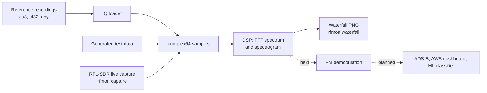

[](https://github.com/grandmas-code-mill/pi-rf-monitor/actions/workflows/ci.yml)
# pi-rf-monitor

A Raspberry Pi edge sensor for listening to real radio signals and processing them with digital signal processing (DSP), designed to grow into a cloud-connected RF monitoring pipeline.

The project is receive-only. It never transmits.


*A 5-second live capture centered on 100.9 MHz, recorded on the Raspberry Pi 5 with an RTL-SDR and drawn with `rfmon capture` and `rfmon waterfall`. The bright band in the middle is the 100.9 MHz FM station; other signals show at about 100.1 and 101.7 MHz. Time runs upward.*

**Status (v0.3.0):** the Pi records live radio. `rfmon capture` records IQ samples from an RTL-SDR receiver, `rfmon waterfall` turns any recording into a spectrogram image, and a systemd service records a capture at every boot. Under that sit a scripted, hardened Pi setup, checksum-verified reference recordings, a tested IQ loader, a Hann-windowed FFT, and a C++ cu8-to-cf32 converter that CI checks against the Python loader. Work is planned in Scrum sprints on Jira, and every change goes through a pull request with CI on Python 3.13 and 3.14.

## Quick start (on the Pi)

```bash
./scripts/install_rtlsdr.sh             # drivers, TV-driver block, rtl_test
source edge/.venv/bin/activate
rfmon capture -f 100.9e6                # 5 s at 2.048 MS/s -> data/captures/<freq>_<utc time>.cu8 + .json
rfmon waterfall data/captures/<file>.cu8   # -> <file>.png, settings read from the .json
```

Frequencies are in hertz, so 100.9 MHz is `100.9e6`.

## Hardware

| Part | Role |
|---|---|
| Raspberry Pi 5 (4GB) | Edge computer that runs capture and DSP |
| Official 27W USB-C power supply | Stable power, including enough current to boot from USB |
| Raspberry Pi Active Cooler | Keeps sustained DSP from throttling the CPU |
| USB 3.0 flash drive (32GB+) | Boot drive, flashed with Raspberry Pi Imager |
| RTL-SDR Blog V3 with dipole antenna kit | Receiver covering roughly 24 MHz to 1.7 GHz |

No hardware is needed to develop or run the tests. Every test runs on generated data, and the reference recordings are downloaded files.

## How it works

Every source of samples produces the same thing: a NumPy array of complex samples (I + jQ) scaled to about -1 to +1. The processing code only ever sees that array, so it doesn't care whether the samples came from a file, a test, or a live radio.



### Working today

- **Pi provisioning.** `scripts/setup_pi.sh` takes a freshly flashed Pi to a ready state: system updates, a ufw firewall that allows only rate-limited SSH, a check that password login is disabled, and the project's Python environment. It's safe to re-run.
- **Reference recordings.** `scripts/fetch_samples.sh` downloads two published recordings into `data/samples/` and verifies each against a SHA-256 checksum, so every machine gets identical data.
- **IQ loader.** `rfmon.iq.load_iq()` reads three formats into complex64 samples:
  - **cu8:** the RTL-SDR's raw format, interleaved unsigned bytes. Each byte is centered on 127.5 and scaled, then each I, Q pair becomes one complex sample.
  - **cf32:** interleaved 32-bit floats, already in complex64 layout.
  - **npy:** NumPy's own format, for saving intermediate results.
- **RTL-SDR setup.** `scripts/install_rtlsdr.sh` installs the `rtl-sdr` tools, blocks the TV-tuner driver that would otherwise claim the dongle, grants USB access through the `plugdev` group, and verifies the receiver with `rtl_test`.
- **Live capture.** `rfmon capture` runs the `rtl_sdr` tool and checks the result before trusting it: the frequency must be in the tuner's range, the sample rate must be one the dongle supports, and the file must be exactly 2 bytes per sample. Each capture gets a JSON sidecar with its frequency, sample rate, gain, and UTC start time.
- **Capture at boot.** `scripts/install_capture_service.sh` installs `rfmon-capture.service`, a systemd unit that records one capture per boot as a normal user, retries if the dongle isn't ready, and logs to the journal. Station, length, and gain live in `/etc/default/rfmon-capture`.
- **`rfmon` command.** `rfmon capture`, `rfmon waterfall`, `--help`, and `--version`. Bad paths and settings print one clear error line instead of a traceback.
- **Spectrum.** `rfmon.dsp.spectrum()` turns one block of samples into power in dB per frequency bin, using a Hann window, with real radio frequencies on each bin. Verified with synthetic test tones.
- **Spectrogram and waterfall.** `rfmon.dsp.spectrogram()` runs the same FFT over back-to-back blocks, so each row is one moment in time. `rfmon waterfall` saves it as a PNG with frequency in MHz across and time going up. Tests include a tone that changes frequency halfway, which must move columns at the right row.
- **C++ IQ converter.** `edge/cpp/src/iq_convert.cpp` converts cu8 files to cf32 files that the IQ loader can read. CI builds it with warnings treated as errors and checks that its output matches the Python loader exactly.

### Next (v0.4.0)

1. **FM demodulation:** shift a station to the center, low-pass filter, decimate, demodulate by the phase difference between consecutive samples, apply de-emphasis, and write a 48 kHz WAV file, first from the reference recording and then from a live capture.
2. **SigMF metadata:** replace the JSON sidecar with the SigMF standard so captures open in other SDR tools.

The Python version is the reference implementation. The C++ cu8 converter is already verified against it in CI, and future C++ steps will be tested against it on the same inputs.

## Data

Recordings are downloaded by a script rather than committed, and `data/samples/` is git-ignored.

```bash
./scripts/fetch_samples.sh   # from the repo root
```

| Recording | Format | Sample rate | Center frequency | Length | Source |
|---|---|---|---|---|---|
| `fm_rds_250k_1Msamples.iq` (FM broadcast) | cf32 (complex64) | 250 kHz | 99.5 MHz | 1,000,000 samples, 4.0 s | [PySDR](https://pysdr.org/content/rds.html) |
| `modes1.bin` (ADS-B aircraft) | cu8, the RTL-SDR's native format | 2 MHz | 1090 MHz | 356,868 samples, 0.18 s | [dump1090](https://github.com/antirez/dump1090) test file (BSD license) |

Expected checksums are in `scripts/samples.sha256`. The script stops with an error if a download doesn't match.

## Design decisions

- **Receive-only.** The project never transmits, so it needs no transmitter license.
- **Hardware-free tests.** CI checks behavior against known answers, such as specific bytes that must convert to specific complex values, so correctness never depends on hardware or what's on the air. Tests that need the downloaded recordings skip in CI and run on the Pi.
- **One sample format for every source.** The data layer was built on recordings while the receiver was on order. Live capture writes the same cu8 format the loader already reads, so the processing code needed no changes.
- **Wrap the proven tool for capture.** `rfmon capture` runs the standard `rtl_sdr` program rather than a Python driver, then verifies its output. It's simpler, and the tests swap in a fake `rtl_sdr`, so capture logic is tested in CI with no radio.
- **Matching the target platform.** The project requires Python 3.13, the version Raspberry Pi OS ships, and CI tests 3.13 and 3.14.
- **Python first, C++ where it counts.** NumPy is quick to write and easy to inspect. C++ is reserved for steps that need to run continuously on the Pi, verified against the Python results and kept only where benchmarks show it helps.

## Known limitations

- **Captures are fixed-length files, not a live stream.** `rfmon capture` records a set number of seconds, then processing runs on the file. Real-time streaming is planned with the C++ capture work.
- **No demodulation yet.** The waterfall shows where and when signals are on the air, but nothing is decoded to audio or data yet. FM is next.
- **Automatic gain can shift the whole picture.** Horizontal stripes across every frequency at once usually mean the gain changed mid-capture; `-g` sets a fixed gain.
- **Formats are chosen by file extension.** Raw IQ files have no header, so `.iq` is read as cf32 and `.bin` as cu8. SigMF metadata files are planned to record each file's format, sample rate, and center frequency.
- **The ADS-B test file is short and old.** `modes1.bin` is a brief 2013 capture with only a few aircraft, enough for decoder tests but not for a busy map.

## Roadmap

- [x] **v0.1.0: Platform and data layer** *(Linux, Raspberry Pi, Bash, Agile)*
  - Headless Raspberry Pi OS on USB with key-only SSH and a ufw firewall
  - Scripted, re-runnable provisioning and checksum-verified data downloads
  - IQ loader for cu8, cf32, and npy with pytest coverage
  - CI on every push and pull request; work tracked in Jira Scrum sprints
- [x] **v0.2.0: DSP core and first C++** *(DSP, Python, NumPy, C++, CMake)*
  - Hann-windowed FFT with power in dB and real radio frequencies on each bin
  - Synthetic tone tests, such as a known tone that must peak in the expected FFT bin
  - A C++ cu8-to-cf32 converter, built in CI and verified against the Python loader
- [x] **v0.3.0: Live capture and spectrogram** *(Raspberry Pi hardware, Linux drivers, systemd, DSP)*
  - RTL-SDR driver setup script and `rtl_test` verification
  - `rfmon capture` with input checks, file-size verification, and a JSON metadata sidecar
  - Spectrogram and `rfmon waterfall` PNG output, for recordings and live captures
  - A systemd service that records a capture at every boot
- [ ] **v0.4.0: FM demodulation** *(DSP)*
  - FM demodulation to a 48 kHz WAV file, from the reference recording and live captures
  - SigMF metadata for each recording
- [ ] **C++ on the edge** *(C++, CMake, embedded Linux)*
  - Speed-critical DSP steps in C++ with Python bindings, benchmarked against NumPy on the Pi
  - Capture threads and a ring buffer using librtlsdr
- [ ] **ADS-B and MATLAB** *(DSP, MATLAB)*
  - Decode aircraft messages at 1090 MHz, starting from the dump1090 test file
  - Prototype filter designs in MATLAB and compare them with the Python implementation
- [ ] **Cloud pipeline** *(AWS, Kubernetes, Docker)*
  - Containerize the edge software and stream results from the Pi to AWS
  - A Kubernetes-hosted backend and dashboard, including an aircraft map
  - Infrastructure as code and continuous deployment
- [ ] **ML signal classifier** *(AI/ML, PyTorch)*
  - A CNN that labels signal types from spectrograms, trained on public datasets and then local captures
- [ ] **Stretch**
  - NOAA weather satellite images, and multiple Pi sensor nodes

## Running it

Requires Python 3.13+.

```bash
git clone https://github.com/grandmas-code-mill/pi-rf-monitor.git
cd pi-rf-monitor
./scripts/fetch_samples.sh          # optional: enables the real-recording tests

cd edge
python -m venv .venv
source .venv/bin/activate
pip install -e ".[dev]"
cmake -S cpp -B cpp/build && cmake --build cpp/build   # optional: builds the C++ converter and enables its tests
ruff check .
pytest
rfmon --version
```

Draw a waterfall from a reference recording (no radio needed):

```bash
rfmon waterfall ../data/samples/fm_rds_250k_1Msamples.iq -r 250e3 -c 99.5e6
```

Load a recording from Python:

```python
from rfmon.iq import load_iq

samples = load_iq("../data/samples/modes1.bin")
print(samples.shape, samples.dtype)   # (356868,) complex64
```

**On the Raspberry Pi,** follow [docs/pi-setup.md](docs/pi-setup.md): `./scripts/setup_pi.sh` creates the Python environment in `edge/.venv`, `./scripts/install_rtlsdr.sh` sets up the receiver, and `./scripts/install_capture_service.sh` turns on capture at boot.

## Project structure

```
edge/rfmon/cli.py            rfmon command-line entry point
edge/rfmon/iq.py             IQ recording loaders (cu8, cf32, npy)
edge/rfmon/dsp.py            windowed FFT spectrum and spectrogram
edge/rfmon/capture.py        live capture through rtl_sdr, with a JSON sidecar
edge/rfmon/plot.py           waterfall PNG output
edge/cpp/                    C++ cu8-to-cf32 converter and its CMake build
edge/tests/                  pytest suite, run by CI with no hardware
edge/pyproject.toml          dependencies, Ruff and pytest settings
scripts/setup_pi.sh          Raspberry Pi provisioning
scripts/fetch_samples.sh     download and verify the reference recordings
scripts/samples.sha256       expected recording checksums
scripts/install_rtlsdr.sh    RTL-SDR drivers and receiver check
scripts/install_capture_service.sh   install the capture-at-boot service
scripts/systemd/             systemd unit and its default settings
data/samples/                downloaded recordings (git-ignored)
data/captures/               live captures (git-ignored)
docs/pi-setup.md             Raspberry Pi setup guide
docs/img/                    README images
.github/workflows/ci.yml     lint and test on Python 3.13 and 3.14
LICENSE                      The Unlicense
```

## License

The Unlicense. See `LICENSE`.

## Credits

[PySDR](https://pysdr.org/) for DSP explanations and the FM recording, [dump1090](https://github.com/antirez/dump1090) for the ADS-B test file, [RTL-SDR Blog](https://www.rtl-sdr.com/) for hardware guides and drivers, the [osmocom rtl-sdr](https://osmocom.org/projects/rtl-sdr/wiki) project for the `rtl_sdr` and `rtl_test` tools, and the [Raspberry Pi documentation](https://www.raspberrypi.com/documentation/).