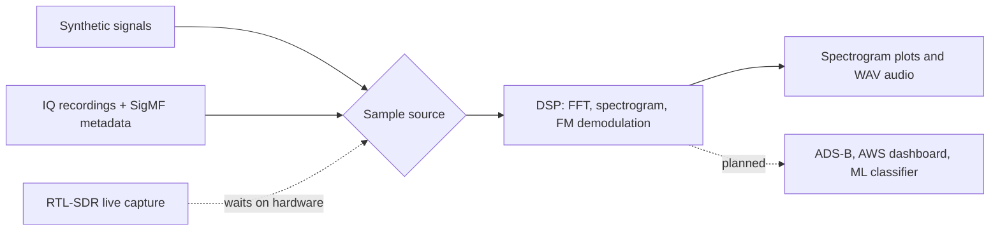

[](https://github.com/grandmas-code-mill/pi-rf-monitor/actions/workflows/ci.yml)
# pi-rf-monitor

A Raspberry Pi edge sensor that listens to real radio signals, processes them with digital signal processing (DSP), and is designed to stream the results to a cloud dashboard.

The project is receive-only. It never transmits.

**Status:** Sprint 1 of a two-week Scrum cadence. The Pi is running headless with key-only SSH, and the DSP is being built and tested against published IQ recordings while the RTL-SDR receiver is on order. Live capture is the one piece that waits on hardware. See [Roadmap](#roadmap).

## Hardware

| Part | Role |
|---|---|
| Raspberry Pi 5 (4GB) | Edge computer that runs capture and DSP |
| Official 27W USB-C power supply | Stable power, including enough current to boot from USB |
| Raspberry Pi Active Cooler | Keeps sustained DSP from throttling the CPU |
| USB 3.0 flash drive (32GB+) | Boot drive, flashed with Raspberry Pi Imager |
| RTL-SDR Blog V3 with dipole antenna kit | Receiver covering roughly 24 MHz to 1.7 GHz *(on order)* |

None of the hardware is needed to develop or run the tests. Every test runs on synthetic signals or recordings.

## How it works

Samples reach the DSP through one sample-source interface, so the processing code doesn't care where they came from.



### 1. Sample sources

- **Synthetic:** generated tones and FM-modulated signals with known answers, used by the tests.
- **Recordings:** published IQ files, each with a SigMF `.sigmf-meta` file that records its sample rate, center frequency, and data type.
- **Live SDR:** the RTL-SDR, added behind the same interface once the hardware arrives.

### 2. Signal processing

1. **Spectrum:** a Hann-windowed FFT with power in dB, and a scrolling spectrogram (waterfall) with the frequency axis in real MHz.
2. **FM demodulation:** shift the station to the center, low-pass filter, decimate, demodulate by the phase difference between consecutive samples, apply de-emphasis, and write a 48 kHz WAV file.

The Python version is the reference implementation. A C++ core for the speed-critical steps is planned, and it will be tested against the Python output on the same inputs.

## Data

Recordings are downloaded by a script rather than committed, and `data/samples/` is git-ignored.

| Recording | Format | Used for | Source |
|---|---|---|---|
| FM broadcast | IQ recording | Spectrum, spectrogram, FM demodulation | [PySDR](https://pysdr.org/content/rds.html) |
| ADS-B (`modes1.bin`) | 8-bit unsigned IQ at 2 MS/s, the RTL-SDR's native format | Loader tests, future ADS-B decoding | [dump1090](https://github.com/antirez/dump1090) test file (BSD license) |

## Design decisions

- **Receive-only.** The project never transmits, so it needs no transmitter license.
- **Hardware-free tests.** CI checks the DSP against signals with known answers, such as a tone that must peak in a specific FFT bin, so correctness never depends on what's on the air.
- **One interface for every sample source.** The DSP is being built on recordings while the receiver is on order. Live capture will plug in without changes to the processing code.
- **Metadata travels with the data.** A raw IQ file is just numbers. SigMF files keep the sample rate and center frequency next to each recording, so the loader reads them instead of hard-coding them.
- **Python first, C++ where it counts.** NumPy is quick to write and easy to inspect. C++ is reserved for steps that need to run continuously on the Pi, and only once benchmarks show it helps.

## Known limitations

- **No live capture yet.** Until the RTL-SDR arrives, all processing runs on recordings made with other hardware in other places.
- **Real-time performance is unmeasured.** Whether the Python DSP keeps up with a live stream on the Pi will be benchmarked before any C++ work begins.
- **The ADS-B test file is short and old.** `modes1.bin` is a brief 2013 capture with only a few aircraft, so it's enough for decoder tests but not for a busy map.

## Roadmap

- [x] **Foundation:** Jira Scrum board, pull-request workflow, CI with Ruff and pytest
- [ ] **Pi platform:** headless OS on USB, key-only SSH, ufw firewall, Bash setup scripts ([setup guide](docs/pi-setup.md))
- [ ] **DSP core on recordings:** IQ loader with SigMF, FFT and spectrogram, FM demodulation, synthetic-signal tests
- [ ] **v0.1.0 release**
- [ ] **Live RF capture:** RTL-SDR source, `rtl_test`, recordings of local signals
- [ ] **ADS-B and MATLAB:** decode aircraft positions at 1090 MHz, prototype filter designs in MATLAB
- [ ] **C++ DSP core:** speed-critical steps in C++ via pybind11, benchmarked against NumPy
- [ ] **Cloud pipeline:** Docker, streaming from the Pi to AWS, a Kubernetes backend, and a dashboard with an aircraft map
- [ ] **ML signal classifier:** a CNN that labels signal types from spectrograms
- [ ] **Stretch:** NOAA weather satellite images, multiple Pi sensor nodes

## Running it

Requires Python 3.14+.

```bash
git clone https://github.com/grandmas-code-mill/pi-rf-monitor.git
cd pi-rf-monitor/edge
python -m venv .venv
source .venv/bin/activate
pip install -e ".[dev]"
ruff check .
pytest
```

On the Raspberry Pi, also install the SDR bindings with `pip install -e ".[sdr]"`. Provisioning the Pi itself (OS install, SSH hardening, firewall, and drivers) is covered in [docs/pi-setup.md](docs/pi-setup.md).

The `rfmon` command-line tool is in development. Planned commands:

```bash
rfmon spectrum --file data/samples/<recording>   # Spectrogram of a recording
rfmon fm --file data/samples/<recording>         # Demodulate FM to a WAV file
rfmon capture --freq 98.1e6 --seconds 5          # Record live IQ samples (needs the RTL-SDR)
```

## Project structure

```
edge/rfmon/                  Python package (DSP, sample sources, CLI)
edge/tests/                  pytest suite, run by CI with no hardware
edge/pyproject.toml          dependencies, Ruff and pytest settings
docs/pi-setup.md             Raspberry Pi provisioning guide
.github/workflows/ci.yml     lint and test on every push and pull request
LICENSE                      The Unlicense
```

## License

The Unlicense. See `LICENSE`.

## Credits

[RTL-SDR Blog](https://www.rtl-sdr.com/) for hardware guides and drivers, [pyrtlsdr](https://github.com/pyrtlsdr/pyrtlsdr) for the Python bindings, [PySDR](https://pysdr.org/) for DSP explanations and the FM recording, and the [Raspberry Pi documentation](https://www.raspberrypi.com/documentation/).
