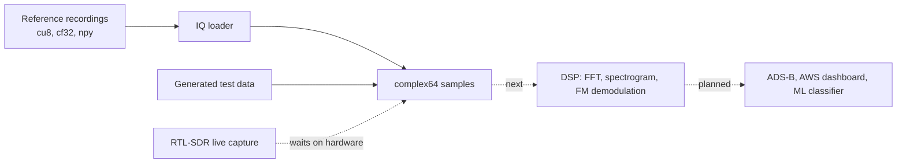

[](https://github.com/grandmas-code-mill/pi-rf-monitor/actions/workflows/ci.yml)
# pi-rf-monitor

A Raspberry Pi edge sensor for listening to real radio signals and processing them with digital signal processing (DSP), designed to grow into a cloud-connected RF monitoring pipeline.

The project is receive-only. It never transmits.

**Status (v0.1.0):** the Pi platform and the data layer are in place. A hardened, headless Raspberry Pi is provisioned by script, reference radio recordings download with checksum verification, and a tested loader turns them into complex samples ready for DSP. The FFT and spectrogram are next. Live capture waits on the RTL-SDR receiver, which is on order. Work is planned in two-week Scrum sprints on Jira, and every change goes through a pull request with CI.

## Hardware

| Part | Role |
|---|---|
| Raspberry Pi 5 (4GB) | Edge computer that runs capture and DSP |
| Official 27W USB-C power supply | Stable power, including enough current to boot from USB |
| Raspberry Pi Active Cooler | Keeps sustained DSP from throttling the CPU |
| USB 3.0 flash drive (32GB+) | Boot drive, flashed with Raspberry Pi Imager |
| RTL-SDR Blog V3 with dipole antenna kit | Receiver covering roughly 24 MHz to 1.7 GHz *(on order)* |

No hardware is needed to develop or run the tests. Every test runs on generated data, and the reference recordings are downloaded files.

## How it works

Every source of samples produces the same thing: a NumPy array of complex samples (I + jQ) scaled to about -1 to +1. The processing code only ever sees that array, so it doesn't care whether the samples came from a file, a test, or a live radio.



### Working today

- **Pi provisioning.** `scripts/setup_pi.sh` takes a freshly flashed Pi to a ready state: system updates, a ufw firewall that allows only rate-limited SSH, a check that password login is disabled, and the project's Python environment. It's safe to re-run.
- **Reference recordings.** `scripts/fetch_samples.sh` downloads two published recordings into `data/samples/` and verifies each against a SHA-256 checksum, so every machine gets identical data.
- **IQ loader.** `rfmon.iq.load_iq()` reads three formats into complex64 samples:
  - **cu8:** the RTL-SDR's raw format, interleaved unsigned bytes. Each byte is centered on 127.5 and scaled, then each I, Q pair becomes one complex sample.
  - **cf32:** interleaved 32-bit floats, already in complex64 layout.
  - **npy:** NumPy's own format, for saving intermediate results.
- **`rfmon` command.** `rfmon --help` and `rfmon --version` work, with subcommands added as each feature lands.

### Next (v0.2.0)

1. **Spectrum:** a Hann-windowed FFT with power in dB, and a spectrogram (waterfall) with the frequency axis in real MHz.
2. **FM demodulation:** shift a station to the center, low-pass filter, decimate, demodulate by the phase difference between consecutive samples, apply de-emphasis, and write a 48 kHz WAV file.

The Python version is the reference implementation. C++ versions of the speed-critical steps will be tested against it on the same inputs.

## Data

Recordings are downloaded by a script rather than committed, and `data/samples/` is git-ignored.

```bash
./scripts/fetch_samples.sh   # from the repo root
```

| Recording | Format | Sample rate | Center frequency | Length | Source |
|---|---|---|---|---|---|
| `fm_rds_250k_1Msamples.iq` (FM broadcast) | cf32 (complex64) | 250 kHz | 99.5 MHz | 1,000,000 samples, 4.0 s | [PySDR](https://pysdr.org/content/rds.html) |
| `modes1.bin` (ADS-B aircraft) | cu8, the RTL-SDR's native format | 2 MHz | 1090 MHz | 356,868 samples, 0.18 s | [dump1090](https://github.com/antirez/dump1090) test file (BSD license) |

Expected checksums are in `scripts/samples.sha256`. The script stops with an error if a download doesn't match.

## Design decisions

- **Receive-only.** The project never transmits, so it needs no transmitter license.
- **Hardware-free tests.** CI checks behavior against known answers, such as specific bytes that must convert to specific complex values, so correctness never depends on hardware or what's on the air. Tests that need the downloaded recordings skip in CI and run on the Pi.
- **One sample format for every source.** The data layer was built on recordings while the receiver is on order. Live capture will produce the same array and plug in without changes to the processing code.
- **Matching the target platform.** The project requires Python 3.13, the version Raspberry Pi OS ships, and CI tests 3.13 and 3.14.
- **Python first, C++ where it counts.** NumPy is quick to write and easy to inspect. C++ is reserved for steps that need to run continuously on the Pi, verified against the Python results and kept only where benchmarks show it helps.

## Known limitations

- **No live capture yet.** Until the RTL-SDR arrives, all processing runs on recordings made with other hardware in other places.
- **No DSP yet.** v0.1.0 covers the platform and data layer. The FFT is the next milestone.
- **Formats are chosen by file extension.** Raw IQ files have no header, so `.iq` is read as cf32 and `.bin` as cu8. SigMF metadata files are planned to record each file's format, sample rate, and center frequency.
- **The ADS-B test file is short and old.** `modes1.bin` is a brief 2013 capture with only a few aircraft, enough for decoder tests but not for a busy map.

## Roadmap

- [x] **v0.1.0: Platform and data layer** *(Linux, Raspberry Pi, Bash, Agile)*
  - Headless Raspberry Pi OS on USB with key-only SSH and a ufw firewall
  - Scripted, re-runnable provisioning and checksum-verified data downloads
  - IQ loader for cu8, cf32, and npy with pytest coverage
  - CI on every push and pull request; work tracked in Jira Scrum sprints
- [ ] **v0.2.0: DSP core** *(DSP, Python, NumPy)*
  - Hann-windowed FFT, power in dB, and a spectrogram labeled in MHz
  - FM demodulation from the reference recording to a WAV file
  - Synthetic-signal tests, such as a known tone that must peak in the expected FFT bin
  - SigMF metadata for each recording
- [ ] **C++ on the edge** *(C++, CMake, embedded Linux)*
  - A C++ cu8-to-cf32 converter, built in CI and verified against the Python loader
  - Speed-critical DSP steps in C++ with Python bindings, benchmarked against NumPy on the Pi
  - Capture threads and a ring buffer using librtlsdr
- [ ] **Live RF capture** *(Raspberry Pi hardware, Linux drivers)*
  - RTL-SDR driver setup script and `rtl_test` verification
  - A live SDR source behind the same sample interface, plus recordings of local signals
- [ ] **ADS-B and MATLAB** *(DSP, MATLAB)*
  - Decode aircraft messages at 1090 MHz, starting from the dump1090 test file
  - Prototype filter designs in MATLAB and compare them with the Python implementation
- [ ] **Cloud pipeline** *(AWS, Kubernetes, Docker)*
  - Containerize the edge software and stream results from the Pi to AWS
  - A Kubernetes-hosted backend and dashboard, including an aircraft map
  - Infrastructure as code and continuous deployment
- [ ] **ML signal classifier** *(AI/ML, PyTorch)*
  - A CNN that labels signal types from spectrograms, trained on public datasets and then local captures
- [ ] **Stretch**
  - NOAA weather satellite images, and multiple Pi sensor nodes

## Running it

Requires Python 3.13+.

```bash
git clone https://github.com/grandmas-code-mill/pi-rf-monitor.git
cd pi-rf-monitor
./scripts/fetch_samples.sh          # optional: enables the real-recording tests

cd edge
python -m venv .venv
source .venv/bin/activate
pip install -e ".[dev]"
ruff check .
pytest
rfmon --version
```

Load a recording from Python:

```python
from rfmon.iq import load_iq

samples = load_iq("../data/samples/modes1.bin")
print(samples.shape, samples.dtype)   # (356868,) complex64
```

**On the Raspberry Pi,** follow [docs/pi-setup.md](docs/pi-setup.md), then run `./scripts/setup_pi.sh` from the repo root. It creates the Python environment in `edge/.venv` for you.

## Project structure

```
edge/rfmon/cli.py            rfmon command-line entry point
edge/rfmon/iq.py             IQ recording loaders (cu8, cf32, npy)
edge/tests/                  pytest suite, run by CI with no hardware
edge/pyproject.toml          dependencies, Ruff and pytest settings
scripts/setup_pi.sh          Raspberry Pi provisioning
scripts/fetch_samples.sh     download and verify the reference recordings
scripts/samples.sha256       expected recording checksums
data/samples/                downloaded recordings (git-ignored)
docs/pi-setup.md             Raspberry Pi setup guide
.github/workflows/ci.yml     lint and test on Python 3.13 and 3.14
LICENSE                      The Unlicense
```

## License

The Unlicense. See `LICENSE`.

## Credits

[PySDR](https://pysdr.org/) for DSP explanations and the FM recording, [dump1090](https://github.com/antirez/dump1090) for the ADS-B test file, [RTL-SDR Blog](https://www.rtl-sdr.com/) for hardware guides and drivers, [pyrtlsdr](https://github.com/pyrtlsdr/pyrtlsdr) for the Python bindings, and the [Raspberry Pi documentation](https://www.raspberrypi.com/documentation/).
