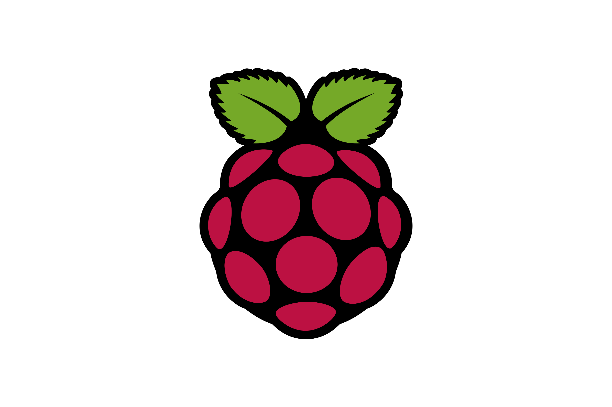

<!-- Improved compatibility of back to top link: See: https://github.com/othneildrew/Best-README-Template/pull/73 -->
<a id="readme-top"></a>


<!-- PROJECT SHIELDS -->
<!--
*** Reference-style links are used for readability.
*** See the bottom of this document for the link definitions.
*** https://www.markdownguide.org/basic-syntax/#reference-style-links
-->

[](https://github.com/grandmas-code-mill/pi-rf-monitor/actions/workflows/ci.yml)


<!-- PROJECT LOGO -->
<br />
<div align="center">
  <a href="https://github.com/grandmas-code-mill/pi-rf-monitor/tree/main">
    
  </a>

  <h3 align="center">pi-rf-monitor</h3>

  <p align="center">
    A Raspberry Pi edge sensor that listens to real radio signals, processes them with DSP, and streams the results to a cloud dashboard.
    <br />
    <a href="docs/"><strong>Explore the docs »</strong></a>
    <br />
    <br />
    <!-- TODO: link to a demo video or GIF once Sprint 1 is complete -->
    <a href="#usage">View Demo</a>
    &middot;
    <a href="https://github.com/grandmas-code-mill/pi-rf-monitor/issues/new?labels=bug">Report Bug</a>
    &middot;
    <a href="https://github.com/grandmas-code-mill/pi-rf-monitor/issues/new?labels=enhancement">Request Feature</a>
  </p>
</div>


<!-- TABLE OF CONTENTS -->
<details>
  <summary>Table of Contents</summary>
  <ol>
    <li>
      <a href="#about-the-project">About The Project</a>
      <ul>
        <li><a href="#built-with">Built With</a></li>
      </ul>
    </li>
    <li>
      <a href="#getting-started">Getting Started</a>
      <ul>
        <li><a href="#prerequisites">Prerequisites</a></li>
        <li><a href="#installation">Installation</a></li>
      </ul>
    </li>
    <li><a href="#usage">Usage</a></li>
    <li><a href="#roadmap">Roadmap</a></li>
    <li><a href="#contributing">Contributing</a></li>
    <li><a href="#license">License</a></li>
    <li><a href="#contact">Contact</a></li>
    <li><a href="#acknowledgments">Acknowledgments</a></li>
  </ol>
</details>


<!-- ABOUT THE PROJECT -->
## About The Project

<!-- TODO: replace with a screenshot or GIF of the live spectrogram -->
[![pi-rf-monitor screenshot][product-screenshot]](#usage)

pi-rf-monitor turns a Raspberry Pi and a low-cost RTL-SDR receiver into a radio monitoring station. The Pi captures raw radio samples, processes them with digital signal processing (DSP), and identifies what it hears. Results stream to AWS, where a web dashboard shows a live spectrum view and a map of nearby aircraft.

What it does:
* **Captures RF** from roughly 24 MHz to 1.7 GHz, and saves raw IQ samples for live or offline processing
* **Visualizes the spectrum** with a live scrolling spectrogram (waterfall), labeled in real frequencies
* **Demodulates FM broadcast radio** into listenable audio, proving the full DSP chain end to end
* **Tracks aircraft** by decoding ADS-B position broadcasts at 1090 MHz *(planned)*
* **Classifies signals** with a small neural network trained on spectrograms *(planned)*
* **Streams to the cloud** with a containerized backend on AWS and Kubernetes *(planned)*

The project is receive-only. It never transmits.

Development runs in two-week Scrum sprints tracked in Jira, with every change going through a pull request and automated linting and tests in GitHub Actions.

<p align="right">(<a href="#readme-top">back to top</a>)</p>


### Built With

* [![Python][Python]][Python-url]
* [![NumPy][NumPy]][NumPy-url]
* [![SciPy][SciPy]][SciPy-url]
* [![Matplotlib][Matplotlib]][Matplotlib-url]
* [![Raspberry Pi][RaspberryPi]][RaspberryPi-url]
* [![GitHub Actions][GitHubActions]][GitHubActions-url]

<p align="right">(<a href="#readme-top">back to top</a>)</p>


<!-- GETTING STARTED -->
## Getting Started

You can develop and run the tests on any computer, with no radio hardware attached. The SDR hardware is only needed for live capture on the Pi.

### Prerequisites

Software:
* Python 3.14 or newer
  ```sh
  python --version
  ```
* [Raspberry Pi Imager](https://www.raspberrypi.com/software/), to flash the Pi's operating system

Hardware (for live capture):
* Raspberry Pi 5 (4GB)
* Official Raspberry Pi 27W USB-C power supply
* Raspberry Pi Active Cooler
* RTL-SDR Blog V3 dongle with dipole antenna kit
* USB 3.0 flash drive (32GB or larger) to boot the Pi

### Installation

1. Clone the repo
   ```sh
   git clone https://github.com/grandmas-code-mill/pi-rf-monitor.git
   cd pi-rf-monitor/edge
   ```
2. Create and activate a virtual environment
   ```sh
   python -m venv .venv
   source .venv/bin/activate
   ```
3. Install the project with development tools
   ```sh
   pip install -e ".[dev]"
   ```
4. Confirm everything works by running the linter and tests
   ```sh
   ruff check .
   pytest
   ```
5. On the Raspberry Pi, also install the SDR driver bindings
   ```sh
   pip install -e ".[sdr]"
   ```

Full Raspberry Pi provisioning steps (OS install, SSH hardening, firewall, and RTL-SDR drivers) are in [docs/pi-setup.md](docs/pi-setup.md).

<p align="right">(<a href="#readme-top">back to top</a>)</p>


<!-- USAGE EXAMPLES -->
## Usage

<!-- TODO: confirm these commands match your CLI once Sprint 1 is complete -->
The `rfmon` command-line tool is under active development. Planned commands:

```sh
rfmon capture --freq 98.1e6 --seconds 5   # Record 5 seconds of IQ samples at 98.1 MHz
rfmon spectrum --freq 98.1e6              # Show a live spectrogram
rfmon fm --freq 98.1e6                    # Demodulate an FM station to a WAV file
```

_Plain-language explanations of the DSP (FFTs, windowing, decimation, and FM demodulation) will live in `docs/dsp-notes.md`._

<p align="right">(<a href="#readme-top">back to top</a>)</p>


<!-- ROADMAP -->
## Roadmap

- [x] Project setup with automated linting and tests (CI)
- [ ] Provision the Raspberry Pi with repeatable, hardened setup scripts
- [ ] **MVP signal capture**
    - [ ] Capture and save IQ samples
    - [ ] Live spectrum and spectrogram
    - [ ] FM demodulation to audio
    - [ ] Hardware-free tests with synthetic signals
- [ ] **ADS-B aircraft tracking and DSP depth**
    - [ ] Decode aircraft positions at 1090 MHz
    - [ ] Filter design prototyped in MATLAB
- [ ] **Cloud pipeline**
    - [ ] Containerize with Docker
    - [ ] Stream data from the Pi to AWS
    - [ ] Kubernetes backend and live dashboard with an aircraft map
    - [ ] Continuous deployment
- [ ] **ML signal classifier**
    - [ ] Train a CNN to label signal types from spectrograms
- [ ] **Stretch goals**
    - [ ] Decode NOAA weather satellite images
    - [ ] Support multiple Pi sensor nodes

<p align="right">(<a href="#readme-top">back to top</a>)</p>


<!-- CONTRIBUTING -->
## Contributing

This is a personal portfolio project, but suggestions and bug reports are welcome. Open an issue with the tag "bug" or "enhancement."

To propose a change:

1. Fork the Project
2. Create your Feature Branch (`git checkout -b feature/AmazingFeature`)
3. Commit your Changes (`git commit -m 'Add some AmazingFeature'`)
4. Push to the Branch (`git push origin feature/AmazingFeature`)
5. Open a Pull Request

Pull requests must pass CI (Ruff linting and pytest) before merging.

<p align="right">(<a href="#readme-top">back to top</a>)</p>


<!-- LICENSE -->
## License

Distributed under the Unlicense. See [`LICENSE`][license-url] for more information.

<p align="right">(<a href="#readme-top">back to top</a>)</p>


<!-- CONTACT -->
## Contact

<!-- TODO: add your LinkedIn profile URL in the links section at the bottom -->
Evan Morgan - [LinkedIn][linkedin-url]

Project Link: [https://github.com/grandmas-code-mill/pi-rf-monitor](https://github.com/grandmas-code-mill/pi-rf-monitor)

<p align="right">(<a href="#readme-top">back to top</a>)</p>


<!-- ACKNOWLEDGMENTS -->
## Acknowledgments

* [RTL-SDR Blog](https://www.rtl-sdr.com/), for hardware guides and drivers
* [pyrtlsdr](https://github.com/pyrtlsdr/pyrtlsdr), Python bindings for the RTL-SDR
* [Raspberry Pi Documentation](https://www.raspberrypi.com/documentation/)
* [Best-README-Template](https://github.com/othneildrew/Best-README-Template)
* [Img Shields](https://shields.io)

<p align="right">(<a href="#readme-top">back to top</a>)</p>


<!-- MARKDOWN LINKS & IMAGES -->
<!-- https://www.markdownguide.org/basic-syntax/#reference-style-links -->
[license-url]: https://github.com/grandmas-code-mill/pi-rf-monitor/blob/main/LICENSE
[linkedin-url]: https://www.linkedin.com/in/YOUR-PROFILE
[product-screenshot]: docs/images/screenshot.png
[Python]: https://img.shields.io/badge/python-3670A0?style=for-the-badge&logo=python&logoColor=ffdd54
[Python-url]: https://python.org/
[NumPy]: https://img.shields.io/badge/numpy-013243?style=for-the-badge&logo=numpy&logoColor=white
[NumPy-url]: https://numpy.org/
[SciPy]: https://img.shields.io/badge/SciPy-8CAAE6?style=for-the-badge&logo=scipy&logoColor=white
[SciPy-url]: https://scipy.org/
[Matplotlib]: https://img.shields.io/badge/Matplotlib-11557C?style=for-the-badge&logo=python&logoColor=white
[Matplotlib-url]: https://matplotlib.org/
[RaspberryPi]: https://img.shields.io/badge/Raspberry%20Pi-A22846?style=for-the-badge&logo=raspberrypi&logoColor=white
[RaspberryPi-url]: https://www.raspberrypi.com/
[GitHubActions]: https://img.shields.io/badge/GitHub%20Actions-2088FF?style=for-the-badge&logo=githubactions&logoColor=white
[GitHubActions-url]: https://github.com/features/actions
